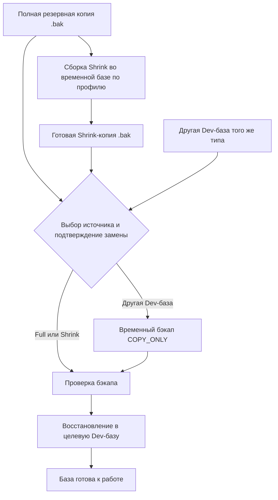

# DevRefresh

DevRefresh — служба Windows с веб-интерфейсом для актуализации баз разработки 1С на Microsoft SQL Server. Разработчик выбирает базу и источник, подтверждает замену данных и получает обновлённую базу в своём контуре. Доступ к SQL Server и каталогам резервных копий настраивает администратор. Разработчику достаточно доступа к DevRefresh.

Сервис помогает быстро подготовить окружение для разработки, тестирования и воспроизведения ошибок на свежих данных. Разработчик запускает обновление самостоятельно или планирует его заранее. Если для задачи достаточно части данных, можно взять заранее подготовленную Shrink-копию и сэкономить место на диске.

## Как это работает



1. Администратор подключает Dev SQL Server, указывает каталоги резервных копий и настраивает доступ сотрудников. Сервис сопоставляет базы с владельцами по именам. При необходимости администратор связывает тип Dev-базы с другим именем бэкапа.
2. Разработчик выбирает доступную базу и один из трёх источников. Для архивов интерфейс показывает дату и размер файла. Готовая Shrink-копия выбирается по умолчанию. При её отсутствии сервис предлагает полную копию.
3. Разработчик подтверждает замену содержимого и запускает задание сразу или на выбранную дату и время. При восстановлении DevRefresh завершает открытые соединения с целевой базой. Текущий этап и результат видны в веб-интерфейсе, подробности сохраняются в журнале.

| Источник | Что получает разработчик |
| --- | --- |
| **Полная копия (Full)** | Базу из полного `.bak`. Сервис подбирает свежий файл для нужного типа базы. |
| **Shrink-копия** | Базу из заранее подготовленного `.bak`, сокращённого по профилю администратора. Дата данных берётся из полной копии, на основе которой собран архив. |
| **Другая Dev-база** | Копию доступной на том же SQL Server базы того же типа. SQL Server создаёт временный бэкап `COPY_ONLY`. База-источник остаётся доступной, а временный файл удаляется после восстановления. |

## Доступ к тестовому контуру

Сервис также показывает базы с окончанием `_tk`, например `uho_ke_tk`. В разделе «Настройки → Доступ и роли» администратор задаёт один список AD-учётных записей для всего тестового контура. Участники списка могут обновлять эти базы из соответствующих Full- и Shrink-бэкапов, сохраняя обычный доступ к собственным Dev-базам. Для `uho_ke_tk` используется тип бэкапа `uho_ke` и его псевдоним, если он настроен.

Список содержит точные имена `DOMAIN\user`, по одному в строке. Роль не даёт административных прав. Администраторы сохраняют доступ ко всем базам. Изменения списка действуют сразу; перед выполнением отложенного задания права проверяются повторно. Копирование между Dev-базами доступно для обычных баз разработки.

## Как готовится Shrink-копия

Администратор анализирует полный бэкап, выбирает таблицы и даты отсечения в профиле сокращения и запускает сборку вручную или по расписанию. DevRefresh восстанавливает полный бэкап во временную базу, применяет профиль и сохраняет результат в отдельный `.bak`. Новая копия становится доступна после проверки, до этого разработчики могут пользоваться предыдущей.

Расписание пропускает сборку, если для этого типа уже доступна Shrink-копия с такой же или более поздней датой данных. Чтобы применить изменённый профиль к полному бэкапу за ту же дату, запустите сборку вручную.

<details>
<summary>Как DevRefresh сокращает большие таблицы</summary>

При сборке обычные удаления фиксируются пакетами до 50 000 строк. Для подходящих таблиц с 250 000 строками и более при удалении от 70% строк сервис может временно сохранить оставшиеся строки, очистить таблицу и вернуть в неё сохранённые данные. Каждая такая операция фиксируется отдельно и требует места во временной базе. Для `BinaryData` этот способ применяется при удалении от 250 000 блоков, если порог достигнут и по числу блоков, и по объёму их содержимого. Порог `RewriteMinDeletePercent` можно задать в диапазоне от 51 до 100 в разделе `Shrink` файла `config/server.json`. Чтобы отключить этот способ, задайте `RewriteTables` значение `false` в том же разделе и перезапустите службу.

</details>

## Анализ Dev-баз

На вкладке «Анализ и сокращение → Анализ Dev-баз» администратор может снять отчёт с доступной базы разработки. В отчёте видны размеры файлов данных и журнала, объём таблиц и индексов и примерное число строк. Таблицы можно найти по имени объекта 1С или SQL-таблицы.

Сервис читает метаданные и статистику базы напрямую. Отчёты сохраняются в папке `dev-analyses` каталога данных DevRefresh и удаляются по одному из интерфейса.

## Установка и обновление

Скачайте пакет для **Windows x64** на странице [GitHub Releases](https://github.com/Xelgo/devrefresh/releases/latest). Установка службы и настройка каталогов описаны в [руководстве по развёртыванию](deploy/portable/README.md).

Для обновления запустите `UPDATE-ONLINE.cmd` от имени администратора Windows в каталоге установки. Команда `UPDATE-ONLINE.cmd -CheckOnly` покажет доступную версию. При переходе с версии ниже 0.2.39 сначала выполните обновление из локального архива по руководству.

Возможность загрузки `.dt` через утилиту 1С `ibcmd` разобрана в [технической записке](docs/ibcmd-dt-restore.md). Текущий процесс восстановления DevRefresh использует `.bak`.

## Сборка и тесты

Сборка выполняется в Windows PowerShell с .NET 10 SDK. Для запуска тестов интерфейса нужен Node.js.

```powershell
.\scripts\Build-Portable.ps1 -Kind Both
dotnet test tests\DevRefresh.Tests\DevRefresh.Tests.csproj
node --test
```

Для интеграционных тестов сокращения установите SQL Server Express LocalDB и задайте `$env:DEVREFRESH_TEST_LOCALDB = '1'` перед запуском `dotnet test`.

Стабильный релиз публикуется с тегом `vMAJOR.MINOR.PATCH`. Для онлайн-обновления приложите архив под именем `DevRefresh-update-win-x64.zip`. Версии тега, пакета и исполняемого файла должны совпадать. Публикуются только сборки. Рабочие данные хранятся в установленном экземпляре.
